<div align="center">



<br/>


-22D3EE?style=for-the-badge)


*Grade manager, calculator, to-do, bank in Python*

[At a Glance](#-at-a-glance) •
[Project Description](#-project-description) •
[Requirements](#-requirements) •
[What Was Ported](#-what-was-ported) •
[Run It](#-run-it) •
[Tests](#-tests) •
[Definition of Done](#-definition-of-done) •
[Known Limits](#-known-limits) •
[Files](#-files)

[Python Lab](../../README.md) · [Project 02](../project-02-network-scanner/) ➡

</div>

---

## 🎯 At a Glance

| | |
|---|---|
| **Status** | ✅ Completed |
| **Needs** | [`01-basics`](../../concepts/01-basics/), [`02-oop-and-modules`](../../concepts/02-oop-and-modules/), [`03-file-io-and-json`](../../concepts/03-file-io-and-json/) |
| **Folder** | `python-by-RDJ/projects/project-01-java-ports` |
| **Author** | Raj Patel (RDJ) |

> **Stage:** ✅ Completed: written, run and explained (written with Claude, disclosed).

**Key:** ✅ completed (written, run and explained in a walkthrough) · 🔄 in progress · ⬜ not started.

## 📌 Project Description
Four of the console projects from `java-by-RDJ/projects` (grade manager, calculator, to-do app, bank system) re-implemented as idiomatic Python. Each has a testable core (pure functions and classes with no `input()`), a small interactive CLI in `main()` guarded by `if __name__ == "__main__":`, a pytest file, and a line-by-line walkthrough that compares it with the Java version. Written with Claude (Sonnet 5.5); authorship disclosed in each file header.

## 📋 Requirements
- Core logic is importable and has no `input()`; the CLI layer takes `read`/`write` callables so tests can drive it.
- Grade manager: Math/Physics/Biology labels everywhere, reject blank names, scores outside 0-100 and non-numeric input, case-insensitive search, class statistics, `dataclass` instead of parallel arrays.
- Calculator: basic and extra operations, division by zero and square root of a negative reported (never a crash), 10-item history, one memory slot, expression parsing with correct precedence and no `eval()`.
- To-do app: priority `Enum`, optional due date, in-memory collection, filter/sort/search/summary, unique ids never reused.
- Bank system: custom exceptions, abstract `Account` with savings and checking, integer-cent money, all-or-nothing transfers, total balance invariant.
- Standard library plus `pytest` only; Python 3.13.

## 📚 What Was Ported
| Python file | Ported from | What changed and why |
|---|---|---|
| `grade_manager.py` | `project-04-grade-manager/StudentGradeManager.java` | Faithful menu and rules. Parallel arrays became a frozen `Student` dataclass and a `GradeBook`. Table header fixed to Physics/Biology (the Java header said Science/English). Typo `viewAllStrudents` dropped. `Scanner` buffer handling replaced by line-based `input()`. |
| `calculator.py` | `project-01-calculator/README.md` (spec only, no Java source) | Implements every requirement plus the expression-parsing extension with a recursive-descent parser. `deque(maxlen=10)` for history. Python-specific traps handled: `**` can return complex, `float('nan')` parses, `%` floors (`math.fmod` used to match Java). |
| `todo_app.py` | `project-02-todo-app/README.md` (spec only) | `Priority` enum, `Task` dataclass with id-based equality, `dict` storage keyed by id, tuple sort keys instead of `Comparator`, sentinel for edit. |
| `bank_system.py` | `project-03-bank-system/README.md` (spec only) | Integer cents instead of `BigDecimal`, `ABC` for abstract class and interface, `...Error` exception names (no checked exceptions in Python), transfer with pre-checks plus rollback. |
| `test_*.py` (4 files) | n/a | pytest suites for each module. |
| `*.md` (4 files) | n/a | Walkthroughs with real output from piped-stdin runs. |

Only `grade_manager` had Java source to port; the other three Java projects exist as specifications (status "Not started" there), so those Python files are implementations of the specs, not translations.

## 🚀 Run It
```bash
cd python-by-RDJ/projects/project-01-java-ports
python3 grade_manager.py
python3 calculator.py
python3 todo_app.py
python3 bank_system.py
# non-interactive example
printf '1\nAda\n90\n80\n70\n2\n5\n' | python3 grade_manager.py
```
Each menu loops until you choose Exit. If piped input runs out, the program exits cleanly.

## 🧪 Tests
```bash
cd python-by-RDJ/projects/project-01-java-ports
python3 -m pytest -q
```
Last run: 184 passed (grade manager 41, calculator 65, to-do 30, bank 48). Edge cases covered: blank names, scores of -1/0/100/101, `1_0` and `85.5` as scores, case-insensitive duplicates, operator precedence and associativity, divide/modulus by zero, sqrt of a negative, overflow, deep nesting, history overflow, due-today not overdue, deleting while iterating, ids never reused, overdraft boundary to the cent, sub-cent amounts, same-account transfer, forced mid-transfer failure with rollback, and a seeded 300-transfer total-balance invariant.

## ✅ Definition of Done
- [x] `grade_manager.py`, `calculator.py`, `todo_app.py`, `bank_system.py` exist and each ends with `if __name__ == "__main__": main()`
- [x] No core function calls `input()`; the CLI layer is `run(read, write)` (check with `grep -n "input(" *.py`: only docstrings/comments and the `read=input` defaults, which pass the function without calling it)
- [x] `python3 -m pytest -q` passes in this folder (184 tests when last run)
- [x] Each CLI was driven with piped stdin and exited with code 0; real output is pasted in its `.md`
- [x] Grade manager uses Math/Physics/Biology consistently; the Java mislabel is documented in `grade_manager.md`
- [x] Calculator never uses `eval()` (check with `grep -n "eval(" calculator.py`: only comments/docs)
- [x] Bank transfers are all-or-nothing, tested including a forced mid-transfer failure
- [x] Each `.py` starts with the required header line and each `.md` follows the Concept / Line-by-Line / Differences / Gotchas / Why layout
- [x] Nothing under `java-by-RDJ` was modified

## 🐛 Known Limits
- Everything is in memory; nothing is saved between runs (the file/JSON need is for a later extension, not implemented).
- Calculator: results show 12 significant digits; no scientific-notation input (`1e5`), no implicit multiplication (`2(3)`), `sqrt` is the only function in expressions.
- Bank: a monthly fee can push a checking account below its overdraft limit; there is no thread safety; the CLI statement uses the real clock so timestamps vary; account state is private by convention only (Python cannot enforce it).
- To-do: no persistence, and `date.fromisoformat` in Python 3.13 also accepts forms like `20260101`.
- Grade manager: invalid-option messages go to stdout (Java used stderr); the class-average rounding uses Python's float formatting, which could differ from Java in an exact `.xx5` tie.
- Three of the four Java sources were specs only, so "faithful port" applies to the grade manager alone.

## 🔗 Files

| File | Kind |
|---|---|
| [`bank_system.md`](./bank_system.md) | Walkthrough |
| [`bank_system.py`](./bank_system.py) | Code |
| [`calculator.md`](./calculator.md) | Walkthrough |
| [`calculator.py`](./calculator.py) | Code |
| [`grade_manager.md`](./grade_manager.md) | Walkthrough |
| [`grade_manager.py`](./grade_manager.py) | Code |
| [`test_bank_system.py`](./test_bank_system.py) | Tests (pytest) |
| [`test_calculator.py`](./test_calculator.py) | Tests (pytest) |
| [`test_grade_manager.py`](./test_grade_manager.py) | Tests (pytest) |
| [`test_todo_app.py`](./test_todo_app.py) | Tests (pytest) |
| [`todo_app.md`](./todo_app.md) | Walkthrough |
| [`todo_app.py`](./todo_app.py) | Code |

---

<div align="center">

### 👨‍💻 Built and owned by Raj Patel (RDJ)

Computer Science undergraduate at **Florida A&M University** · Tallahassee, Florida · GitHub [`raj-famu-dev`](https://github.com/raj-famu-dev)

This is my personal learning lab and portfolio. I build it, I maintain it, and I am accountable for what it claims.

<sub>Completed means written, run and explained in a walkthrough. These files were written with Claude (Sonnet 5.5) and say so in their first line.</sub>

[Python Lab](../../README.md) · [Project 02](../project-02-network-scanner/) ➡

**© 2026 Raj Patel (RDJ).** Released under the [MIT License](../../../LICENSE).

</div>
