<div align="center">



<br/>


-22D3EE?style=for-the-badge)


*Threaded scanner, limited to your own network*

[At a Glance](#-at-a-glance) •
[Project Description](#-project-description) •
[Requirements](#-requirements) •
[Safety and Ethics](#-safety-and-ethics) •
[How It Works](#-how-it-works) •
[Run It](#-run-it) •
[Tests](#-tests) •
[Sample Run](#-sample-run) •
[Definition of Done](#-definition-of-done) •
[Known Limits](#-known-limits) •
[Files](#-files)

⬅ [Project 01](../project-01-java-ports/) · [Python Lab](../../README.md) · [Project 03](../project-03-perceptron-from-scratch/) ➡

</div>

---

## 🎯 At a Glance

| | |
|---|---|
| **Status** | ✅ Completed |
| **Needs** | [`02-oop-and-modules`](../../concepts/02-oop-and-modules/), [`03-file-io-and-json`](../../concepts/03-file-io-and-json/), [`04-network-sockets`](../../concepts/04-network-sockets/) |
| **Folder** | `python-by-RDJ/projects/project-02-network-scanner` |
| **Author** | Raj Patel (RDJ) |

> **Stage:** ✅ Completed: written, run and explained (written with Claude, disclosed).

**Key:** ✅ completed (written, run and explained in a walkthrough) · 🔄 in progress · ⬜ not started.

## 📌 Project Description
A multi-threaded TCP connect port scanner with optional banner grabbing, written with the Python standard library only. It is a learning tool for understanding how sockets, thread pools and timeouts work together, and it is hard-limited in code to machines you control (loopback and private address space).

## 📋 Requirements
- Python 3.13, standard library only (`pytest` is needed just to run the tests).
- CLI via `argparse`: `--target` (default `127.0.0.1`), `--ports` (e.g. `1-1024,8080`), `--timeout`, `--threads`, `--json`, plus `--no-banner`.
- `concurrent.futures.ThreadPoolExecutor` for concurrency and `socket.connect_ex` for the connect attempt.
- For open ports, read a banner passively (short timeout, decode errors replaced, truncated to 128 bytes).
- Safety limits enforced in code: allowed targets, port-count cap (2048), thread cap (100), timeout cap (5 s).

## 🔒 Safety and Ethics
**Scanning hosts you do not own, or do not have written permission to test, is illegal in most places (in the US, for example, under the Computer Fraud and Abuse Act) and can get you banned or prosecuted.** Practice only on your own machine, your own private network, or legal labs and CTF platforms.

What the code enforces (and the tests prove):
- The target is resolved first and **refused with exit code 2** unless every address is loopback (`127.0.0.0/8`, `::1`) or RFC1918 (`10/8`, `172.16/12`, `192.168/16`). The check happens before any socket is created, so a refused target receives no packet from this tool.
- IPv4-mapped IPv6 (`::ffff:8.8.8.8`) is judged as the IPv4 address. A hostname must resolve only to allowed addresses, and the scanner connects to the checked IP, not the name.
- There is **no `--force` flag or override**. Port count, threads and timeout are capped.
- Out of scope by design: UDP, SYN/stealth scans, evasion, vulnerability checks, exploitation.

Note: a private address like `192.168.x.x` is only OK if the machine is yours (or you have permission). The code can only check the address range, not ownership; that part is on you.

## 🧩 How It Works
1. `parse_ports` turns `1-1024,8080` into a sorted list and rejects bad or oversized input.
2. `resolve_and_check` validates the target against the allowed networks. Failure raises `ScanError`, and `main` prints it and returns 2.
3. `scan` maps `scan_port` over the ports with a `ThreadPoolExecutor`. Each worker opens a TCP socket, calls `connect_ex` (0 means open), and always closes the socket.
4. For open ports `grab_banner` waits up to 0.3 s for the server to speak first and keeps at most 128 bytes. Nothing is sent, so servers that wait for the client (such as HTTP) show an empty banner.
5. Results are printed as text or JSON.

## 🚀 Run It
```bash
python3 scanner.py                                  # 127.0.0.1, ports 1-1024
python3 scanner.py --ports 1-1024,8080 --timeout 0.5 --threads 50
python3 scanner.py --target 192.168.1.10 --json     # only if it is YOUR machine
python3 scanner.py --target 8.8.8.8                 # refused, exit code 2
```
Exit codes: `0` scan finished, `2` bad arguments or refused target.

## 🧪 Tests
```bash
python3 -m pytest -q
```
Result of the last run: `35 passed`. The tests start their own loopback servers on port 0 (one with a banner, one silent) and cover open/closed detection, banner capture, truncation and decode-error replacement, port parsing, allowed and refused addresses, the caps, the missing `--force`, and JSON shape. The refusal tests replace `socket.socket`, `getaddrinfo` and `create_connection` with functions that fail the test if called, which proves no network access happens for a refused target such as `8.8.8.8`.

## 📊 Sample Run
Output from a real run against two servers started locally (ports are assigned by the OS, so they differ every run; the third port had nothing listening). `elapsed` is a measurement and varies.
```text
Scanning 127.0.0.1 (127.0.0.1): 3 ports, 50 threads, timeout 0.5s
  48219/tcp open  banner: 'SSH-2.0-DemoServer'
  55599/tcp open
2 open, 1 closed/filtered (elapsed 0.302s, a measurement)
```
JSON mode:
```json
{
  "target": "127.0.0.1",
  "resolved": "127.0.0.1",
  "ports_scanned": 3,
  "open": [
    {"port": 48219, "banner": "SSH-2.0-DemoServer"},
    {"port": 55599, "banner": ""}
  ],
  "elapsed_seconds": 0.302
}
```
(The real output is pretty-printed with `indent=2`; shortened here.) Refusal, with no packet sent:
```text
error: REFUSED: '8.8.8.8' -> 8.8.8.8 is not loopback or private (127.0.0.0/8, ::1, 10/8, 172.16/12, 192.168/16). Only scan machines you own. There is no override.
exit code: 2
```

## ✅ Definition of Done
- [x] `python3 scanner.py` runs with stdlib only and exits 0 on loopback.
- [x] `--target`, `--ports`, `--timeout`, `--threads`, `--json` all work.
- [x] Uses `ThreadPoolExecutor` and `socket.connect_ex`.
- [x] Banner grabbing: short timeout, decode errors replaced, truncated to 128 bytes (tested).
- [x] Non-loopback, non-RFC1918 targets exit with code 2 before any connection (tested with sockets disabled).
- [x] Port range, thread and timeout caps enforced (tested); no `--force` exists (tested).
- [x] `python3 -m pytest -q` passes (35 tests).
- [x] `scanner.md` walkthrough contains real output from a run.

## 🐛 Known Limits
- TCP connect scans only; a closed port and a firewalled port both look "closed/filtered".
- Banners are passive: no data is sent, so HTTP and similar servers show nothing.
- The scanner cannot verify ownership of a private address; it only checks the range.
- A hostname is resolved with the system resolver, which may itself contact a DNS server; use IP literals to avoid that.
- Fixed limits: 2048 ports, 100 threads, 5 s timeout per run. Timing results depend on your machine and load.

## 🔗 Files

| File | Kind |
|---|---|
| [`scanner.md`](./scanner.md) | Walkthrough |
| [`scanner.py`](./scanner.py) | Code |
| [`test_scanner.py`](./test_scanner.py) | Tests (pytest) |

---

<div align="center">

### 👨‍💻 Built and owned by Raj Patel (RDJ)

Computer Science undergraduate at **Florida A&M University** · Tallahassee, Florida · GitHub [`raj-famu-dev`](https://github.com/raj-famu-dev)

This is my personal learning lab and portfolio. I build it, I maintain it, and I am accountable for what it claims.

<sub>Completed means written, run and explained in a walkthrough. These files were written with Claude (Sonnet 5.5) and say so in their first line.</sub>

⬅ [Project 01](../project-01-java-ports/) · [Python Lab](../../README.md) · [Project 03](../project-03-perceptron-from-scratch/) ➡

**© 2026 Raj Patel (RDJ).** Released under the [MIT License](../../../LICENSE).

</div>
