<div align="center">



<br/>


-22D3EE?style=for-the-badge)


*A neural unit in pure Python, no ML libraries*

[At a Glance](#-at-a-glance) •
[Project Description](#-project-description) •
[Requirements](#-requirements) •
[How It Works](#-how-it-works) •
[Run It](#-run-it) •
[Tests](#-tests) •
[Results](#-results) •
[Definition of Done](#-definition-of-done) •
[Known Limits](#-known-limits) •
[Files](#-files)

⬅ [Project 02](../project-02-network-scanner/) · [Python Lab](../../README.md)

</div>

---

## 🎯 At a Glance

| | |
|---|---|
| **Status** | ✅ Completed |
| **Needs** | [`01-basics`](../../concepts/01-basics/), [`02-oop-and-modules`](../../concepts/02-oop-and-modules/) |
| **Folder** | `python-by-RDJ/projects/project-03-perceptron-from-scratch` |
| **Author** | Raj Patel (RDJ) |

> **Stage:** ✅ Completed: written, run and explained (written with Claude, disclosed).

**Key:** ✅ completed (written, run and explained in a walkthrough) · 🔄 in progress · ⬜ not started.

## 📌 Project Description
A single-layer perceptron written in pure Python (standard library only, no NumPy and no ML libraries). It learns with the classic perceptron learning rule, uses a seeded random number generator so every run is reproducible, trains on the AND and OR logic gates and on a seeded, linearly separable 2-D dataset, and demonstrates with measured results that the same neuron cannot learn XOR.

## 📋 Requirements
1. Pure Python 3.13: standard library only; `numpy` and ML libraries are not imported (a test enforces this).
2. A `Perceptron` class with a step activation, weights and a bias, and a `fit` method that applies the perceptron learning rule.
3. All randomness comes from a seeded `random.Random`, so results are reproducible.
4. A command-line program (`python3 perceptron.py`) that trains on AND, OR and a seeded linearly separable 2-D dataset and prints epochs to converge and accuracy.
5. The same program shows that XOR is not learned, reporting the real numbers.
6. Input validation with clear `ValueError` messages.
7. A pytest suite that passes, and a walkthrough (`perceptron.md`) with real results.

## 🧩 How It Works
The neuron computes `z = w1*x1 + w2*x2 + b` and predicts 1 if `z >= 0`, else 0. For each training sample it compares the prediction with the true label. If it is right, nothing changes. If it is wrong, each weight moves by `lr * (label - prediction) * input` and the bias by `lr * (label - prediction)`, nudging the dividing line toward the misclassified point. One full pass over the data is an epoch; training stops when an epoch has no mistakes.

Tiny worked example: weights `[0, 0]`, bias 0, learning rate 0.5, one sample `[1, 2]` with label 0. The net input is 0, so the neuron predicts 1, which is wrong. The error is `0 - 1 = -1`, so the weights become `[-0.5, -1.0]` and the bias `-0.5`. The net input is now `-3`, so it predicts 0, which is right. If the two classes can be separated by a straight line, this process is guaranteed to stop making mistakes (the perceptron convergence theorem). For XOR no such line exists, so it never does.

## 🚀 Run It
From the repository root (the folder that contains `python-by-RDJ/`):
```bash
python3 python-by-RDJ/projects/project-03-perceptron-from-scratch/perceptron.py
python3 -m pytest -q python-by-RDJ/projects/project-03-perceptron-from-scratch
```
Or from inside the project folder: `python3 perceptron.py` and `python3 -m pytest -q`.

## 🧪 Tests
`test_perceptron.py` has 12 tests covering: seeded determinism; AND and OR converging with 100% accuracy; XOR not converging and never reaching 100%, including a grid-search check; the separable dataset converging and scoring at least 90% on a held-out set from a different seed; identical training from identical seeds; the update rule checked by hand (the worked example above); no update when the prediction is already correct; the data generator's margin and labels; input validation; and a guard that `perceptron.py` imports only `random`, `dataclasses` and `__future__`.

Last run: `12 passed in 0.03s`.

## 📊 Results
Real output of `python3 perceptron.py` with seed 42 (two runs were identical):

```text
Seed = 42; learning rate = 0.1; max epochs = 100 (XOR: 1000)

--- Logic gates (4 samples each) ---
AND: converged=True epochs=8 (epochs with updates=7) accuracy=100% weights=(0.139, 0.125) bias=-0.225
OR: converged=True epochs=6 (epochs with updates=5) accuracy=100% weights=(0.239, 0.025) bias=-0.025

--- Seeded linearly separable 2-D dataset ---
train samples=200 test samples=200 (disjoint seeds)
converged=True epochs=2 mistakes per epoch=[5, 0]
train accuracy=100.0% test accuracy=100.0%
learned weights=(0.448, -0.265) bias=0.075
true boundary direction is (2, -1) with bias 0.3: compare ratios, not raw values
learned w1/w2 = -1.693 (true -2.000); bias/|w2| = 0.284 (true 0.300)

--- XOR: a single layer cannot learn it ---
XOR: converged=False epochs run=1000
mistakes per epoch: min=1 max=4 last=3
final accuracy=75% (4 points, so only 0%, 25%, 50%, 75% or 100% are possible)
grid search over 41^3 = 68921 weight settings: best XOR accuracy = 75% (illustration, not a proof)
Why: XOR needs the points (0,1),(1,0) on one side of a line and (0,0),(1,1) on the other;
no straight line does that. A hidden layer (multi-layer network) is needed.
```

These numbers are for seed 42 only; other seeds give other epoch counts. The XOR grid search is an illustration over 68,921 grid points, not a proof.

## ✅ Definition of Done
- [x] `perceptron.py` uses only the standard library (checked by `test_module_uses_only_standard_library`)
- [x] `python3 perceptron.py` exits with code 0 and prints identical output on repeated runs
- [x] AND and OR converge to 100% accuracy (see Results)
- [x] The seeded separable dataset converges to 100% train accuracy and 100% accuracy on a held-out set (seed 42; see Results)
- [x] XOR is shown not to converge in 1000 epochs, with measured numbers
- [x] `python3 -m pytest -q` passes (12 passed)
- [x] `perceptron.md` walkthrough exists, with results copied from real runs

## 🐛 Known Limits
- A single layer can only learn linearly separable problems; XOR needs a hidden layer.
- Convergence is guaranteed only for separable data; on noisy or overlapping data it does not settle.
- It finds some separating line, not the maximum-margin one.
- Binary 0/1 labels only, no probability output.
- Pure Python lists: fine for these toy datasets, slow for large ones.
- Results are for one seed; no averages or general claims are made.

## 🔗 Files

| File | Kind |
|---|---|
| [`perceptron.md`](./perceptron.md) | Walkthrough |
| [`perceptron.py`](./perceptron.py) | Code |
| [`test_perceptron.py`](./test_perceptron.py) | Tests (pytest) |

---

<div align="center">

### 👨‍💻 Built and owned by Raj Patel (RDJ)

Computer Science undergraduate at **Florida A&M University** · Tallahassee, Florida · GitHub [`raj-famu-dev`](https://github.com/raj-famu-dev)

This is my personal learning lab and portfolio. I build it, I maintain it, and I am accountable for what it claims.

<sub>Completed means written, run and explained in a walkthrough. These files were written with Claude (Sonnet 5.5) and say so in their first line.</sub>

⬅ [Project 02](../project-02-network-scanner/) · [Python Lab](../../README.md)

**© 2026 Raj Patel (RDJ).** Released under the [MIT License](../../../LICENSE).

</div>
